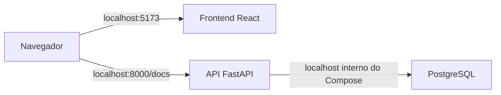

# INATEL C216 — Jogo de bandeiras

Projeto acadêmico de Sistemas Distribuídos com uma interface web, uma API e um banco PostgreSQL. O ambiente completo pode ser iniciado com Docker Compose.

## O que roda

- **Frontend:** React e Vite, servido por Nginx.
- **Backend:** API FastAPI com SQLAlchemy e migrações Alembic.
- **Banco:** PostgreSQL com volume persistente.

## Fluxo



## Executar o projeto

Você só precisa do Docker Desktop com Docker Compose.

1. Abra um terminal na pasta raiz do projeto.
2. Construa as imagens e inicie os serviços:

   ```bash
   docker compose up --build -d
   ```

3. Confira se os três serviços estão ativos:

   ```bash
   docker compose ps
   ```

4. Acesse:

   - Frontend: http://localhost:5173
   - Documentação da API: http://localhost:8000/docs
   - PostgreSQL: localhost:5432

O backend aplica as migrações automaticamente ao iniciar. Nesta etapa, o frontend ainda usa dados locais; a integração com a API fica para a próxima etapa.

## Parar os serviços

```bash
docker compose down
```

Os dados do PostgreSQL permanecem no volume postgres_data quando os containers são parados.

## Estrutura

```text
.
├── .github/workflows/     # CI do backend e do frontend
├── backend/
│   ├── app/
│   │   ├── api/routes/    # Endpoints FastAPI
│   │   ├── repositories/  # Acesso ao banco
│   │   ├── schemas/       # Schemas Pydantic
│   │   ├── services/      # Regras do jogo
│   │   ├── database.py    # Conexão SQLAlchemy
│   │   └── models.py      # Modelos ORM
│   ├── migrations/        # Migrações Alembic
│   └── tests/             # Testes do backend
├── frontend/
│   ├── e2e/               # Testes Playwright
│   ├── public/flags/      # Imagens SVG
│   └── src/
│       ├── components/    # Componentes React
│       └── data/          # Dados locais do quiz
├── docker-compose.yml
└── Makefile
```
